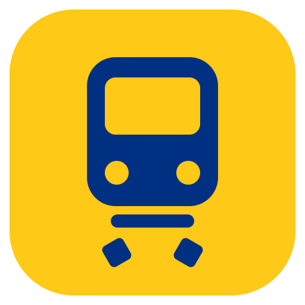
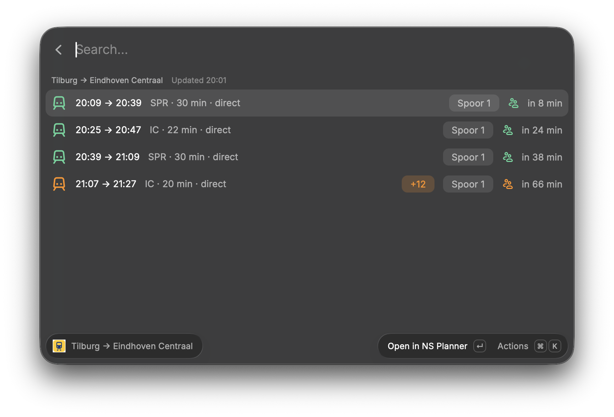
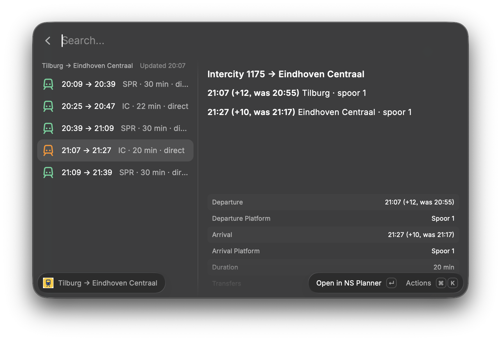
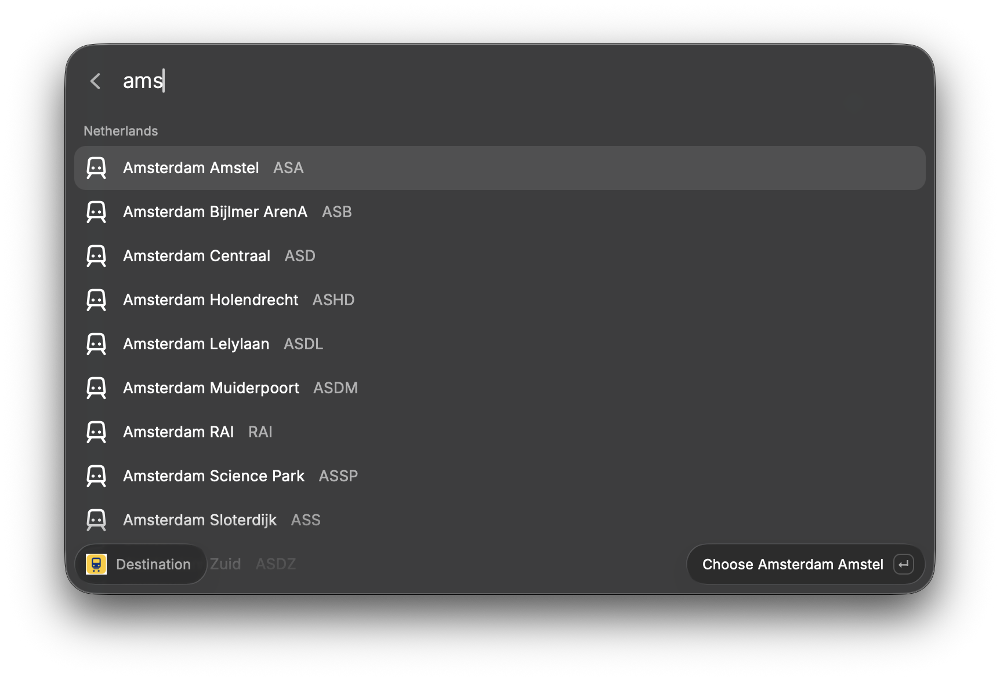
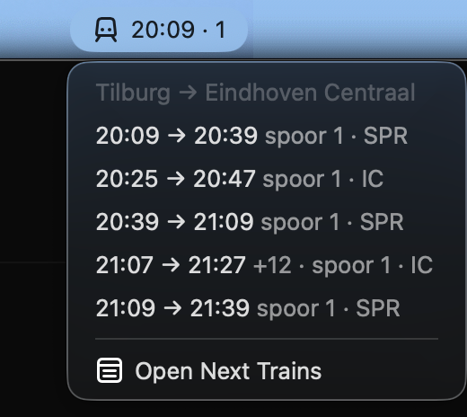

<p align="center">
  
</p>

<h1 align="center">NS Trains for Raycast</h1>

<p align="center">
  Live Dutch railway (NS) departures in Raycast and your menu bar, with delays, platform changes, crowding and disruptions.<br />
  Defaults to <b>Tilburg → Eindhoven Centraal</b>. Pick any station in the Netherlands or abroad.
</p>

<p align="center">
  
</p>

## Features

- **Next Trains**: the upcoming trips on your route, each with:
  - departure → arrival time, with delays included and a `+12`-style tag
  - the platform (*spoor*), highlighted when it changed
  - how busy the train is expected to be, and how many minutes until it leaves
  - cancellations and disruption notices
- **Trip details** (`⌘D`): every leg with its train number and direction, the stops in between, punctuality and the fare.
- **Next Train in Menu Bar**: the next departure always visible, e.g. `20:09 +3 · 1` (time, delay, platform). Click it for the upcoming trains.
- **Any route**: swap direction with `⌘S`, or search all 750+ NS stations (by name, code or spelling variant like "Dusseldorf") for a new departure station or destination. The route is remembered and the menu bar follows it.
- **Gentle on the API**: responses are cached and every command shares one request budget (see [Rate limiting](#rate-limiting)).

<p align="center">
  
</p>

<p align="center">
  
  &nbsp;
  
</p>

## Get an NS API key

The extension uses NS's official **Reisinformatie API**, which needs a free key.

1. Go to the [NS API portal](https://apiportal.ns.nl) and sign up (or sign in).
2. Open **Products** and choose **Ns-App**. It includes the Reisinformatie API (trips) and the Stations API, which the extension needs.
3. Subscribe to it. Any subscription name works, e.g. `Raycast`.
4. Open your **Profile**. Under your subscription you'll see a **Primary key** and a **Secondary key**. Click **Show** and copy the **Primary key**: a 32-character hex string like `0123456789abcdef0123456789abcdef`.

The secondary key works too; NS gives you two so you can rotate one without downtime.
Keep the key to yourself. If it leaks, click **Regenerate** in the portal and paste the new one into Raycast.

## Install

This extension isn't in the Raycast Store, so you run it from source:

```sh
git clone https://github.com/ParelZalm/raycast-ns-trains.git
cd raycast-ns-trains
npm install
npm run dev
```

`npm run dev` (`ray develop`) imports the extension into Raycast. It stays installed after you stop the command.

Then:

1. Open **Next Trains** in Raycast. It asks for the **NS API Key**: paste the primary key from above.
2. Optional: run **Next Train in Menu Bar** once to put the next departure in your menu bar.
3. Optional: change the default route under Raycast Settings → Extensions → NS Trains (**From Station** / **To Station**, as NS station codes like `TB`, `EHV`, `UT`, `ASD`).

## Keyboard shortcuts

| Shortcut | Action |
| --- | --- |
| `↵` | Open the trip in the NS journey planner |
| `⌘D` | Show / hide trip details |
| `⌘R` | Refresh |
| `⌘⇧C` | Copy a one-line trip summary |
| `⌘S` | Swap direction |
| `⌘⇧F` | Choose another departure station |
| `⌘⇧T` | Choose another destination |
| `⌘⇧R` | Back to the default route from the preferences |

## Rate limiting

NS doesn't publish a request limit for the Ns-App product, so the extension stays well under any reasonable one:

- Trips are reused for 60 seconds per route, shared between the list and the menu bar. A manual refresh won't call NS again within 15 seconds.
- The station list is downloaded once a week.
- All commands share a budget of 10 requests per minute.
- If NS answers `429 Too Many Requests`, the extension waits for the `Retry-After` time (60 seconds if NS doesn't send one).
- While it's throttled or offline, the extension shows the last trains it had and says how old they are, instead of an error.

The menu bar refreshes every 2 minutes, which is about 30 requests an hour while your Mac is awake.

## Development

```sh
npm run dev        # ray develop, with hot reload
npm run typecheck  # tsc --noEmit
npm run build      # ray build
```

| Path | What's in it |
| --- | --- |
| `src/api/ns.ts` | NS API client: trips and stations, mapped to small view models |
| `src/api/limiter.ts` | Shared response cache, request budget and `429` back-off |
| `src/next-trains.tsx` | The list command and trip details |
| `src/next-train-menu-bar.tsx` | The menu bar command |
| `src/station-picker.tsx` | Station search used to change the route |
| `src/route.ts` | The remembered route, shared by both commands |

## Disclaimer

This is a personal project. It's not affiliated with or endorsed by NS (Nederlandse Spoorwegen). Travel data © NS, via the [NS API portal](https://apiportal.ns.nl).

## License

[MIT](LICENSE)
